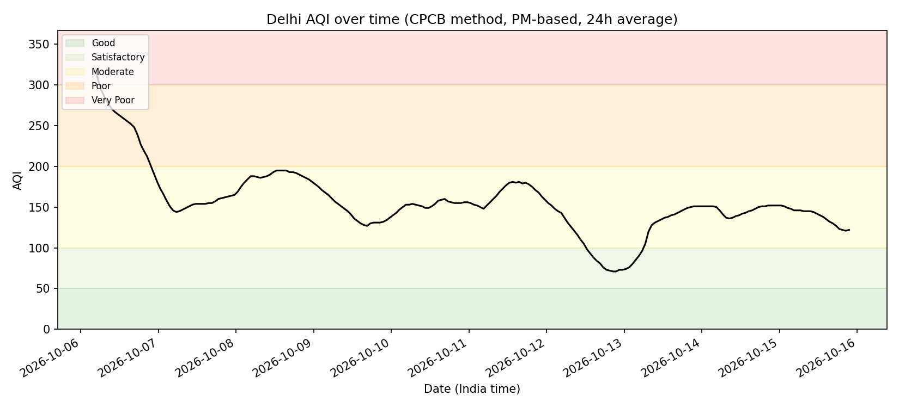
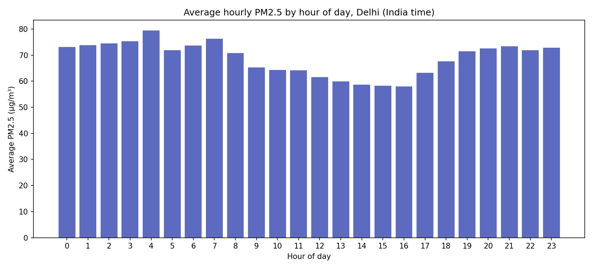
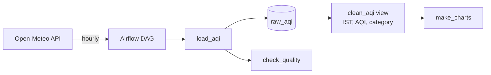

# Delhi AQI Pipeline

An automated data pipeline that collects Delhi's air quality every hour, stores it in PostgreSQL, validates it with data quality checks, and computes India's AQI (CPCB method). Orchestrated with Apache Airflow and fully containerised with Docker.

## What it found





- **Clear daily pattern:** PM2.5 is worst around 4 AM and 7 AM and lowest between 1 PM and 4 PM, about 25% lower. At night, cooler ground air gets trapped under a warmer layer (temperature inversion), holding pollution at breathing height; in the afternoon, sun-heated air rises and disperses it.
- **Day-to-day swings:** AQI moved from Very Poor (~320) on 6 Oct to Satisfactory (~70) on 13 Oct, showing how strongly weather drives Delhi's air quality.

## Architecture



| Step | What happens |
|---|---|
| **Extract** | `load_aqi.py` fetches the past 7 days + 1-day forecast of PM2.5, PM10, NO₂ and ozone for Delhi. |
| **Load** | Rows are upserted into `raw_aqi` (one row per hour). |
| **Validate** | `check_quality.py` runs 5 checks and fails the Airflow task if any fail. |
| **Transform** | The `clean_aqi` SQL view converts to India time, flags forecasts, and computes the CPCB AQI. |
| **Analyse** | `make_charts.py` draws the trend and hour-of-day charts. |

## Engineering highlights

- **Idempotent loads:** a `UNIQUE` constraint plus `INSERT ... ON CONFLICT DO UPDATE` (upsert) means re-running never creates duplicates, and forecasts are refreshed with newer values.
- **Self-healing backfill:** each run fetches the past 7 days, so missed runs (e.g. laptop asleep) are filled automatically.
- **Data quality checks:** non-empty table, no missing values, values in a valid range, no duplicate hours, and no gaps (detected with `generate_series`). A failing check exits with code 1, turning the Airflow task red. The gap check caught a real 48-hour gap during development, which was then backfilled and re-verified.
- **Orchestration:** Airflow DAG `load_aqi >> check_quality`, hourly schedule, 2 retries.
- **Raw vs clean layers:** raw data is never modified; all calculations live in a SQL view, so any logic fix applies to the full history instantly.
- **Containerised:** PostgreSQL and Airflow run in Docker Compose; services talk by name (`postgres:5432`), configured via environment variables.

## AQI method

India's CPCB method: each pollutant's **24-hour average** is converted to a sub-index (0–500) by linear interpolation within its band, and the overall AQI is the **highest** sub-index. Implemented in SQL with window functions (`AVG ... OVER ... ROWS BETWEEN 23 PRECEDING AND CURRENT ROW`) and `CASE` expressions.

## Tech stack

Python · PostgreSQL · SQL (CTEs, window functions, upserts) · Apache Airflow · Docker Compose · pandas · matplotlib

## How to run

Requires Docker Desktop and Python 3.

```bash
git clone https://github.com/abhinitm/delhi-aqi-pipeline.git
cd delhi-aqi-pipeline
pip3 install psycopg2-binary pandas matplotlib

docker compose up -d postgres
docker exec -i aqi_postgres psql -U aqi_user -d aqi_db < sql/create_raw_table.sql
docker exec aqi_postgres psql -U aqi_user -d aqi_db -c "CREATE DATABASE airflow_db;"
docker exec -i aqi_postgres psql -U aqi_user -d aqi_db < sql/clean_aqi_view.sql

docker compose up -d
```

Open the Airflow UI at http://localhost:8080 and turn on the `delhi_aqi_pipeline` DAG. To regenerate charts: `python3 src/make_charts.py`.

## Project structure

```
dags/aqi_pipeline.py      Airflow DAG (load → check)
src/load_aqi.py           extract + upsert into raw_aqi
src/check_quality.py      5 data quality checks
src/make_charts.py        trend and hour-of-day charts
sql/create_raw_table.sql  raw table definition
sql/clean_aqi_view.sql    India time, forecast flag, CPCB AQI
charts/                   generated charts
docker-compose.yml        PostgreSQL + Airflow
```

## Limitations

- **Modelled data:** Open-Meteo provides CAMS atmospheric model data (~45 km grid), not CPCB ground-station readings, so values are smoother and lower than station-based AQI.
- **PM-based AQI:** uses PM2.5 and PM10 only; the official index can include up to 8 pollutants.
- **Runs on a laptop:** collection pauses while the machine sleeps; the 7-day backfill covers gaps.
- **Local-only credentials:** hard-coded passwords and disabled Airflow login are for local development only.

## Next steps

- Add chart generation as a third Airflow task
- Compare against CPCB station data
- Track AQI through Delhi's winter peak (November–January)